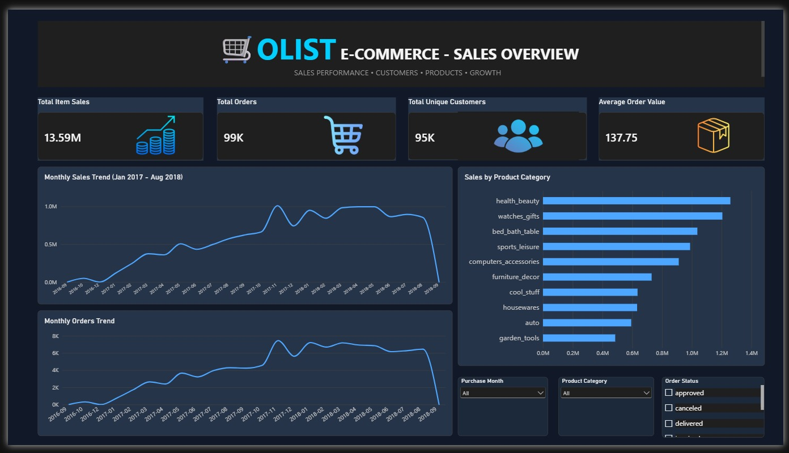
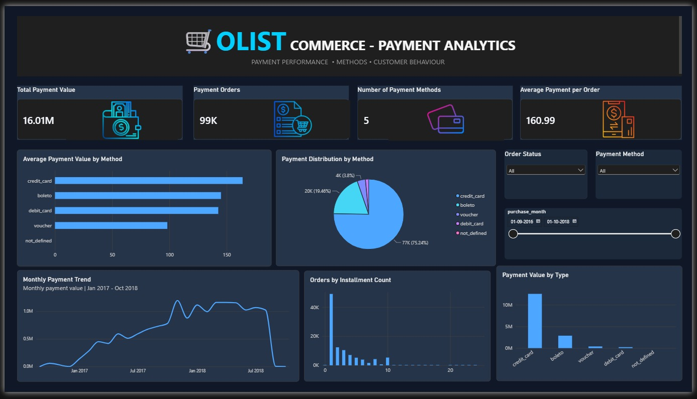
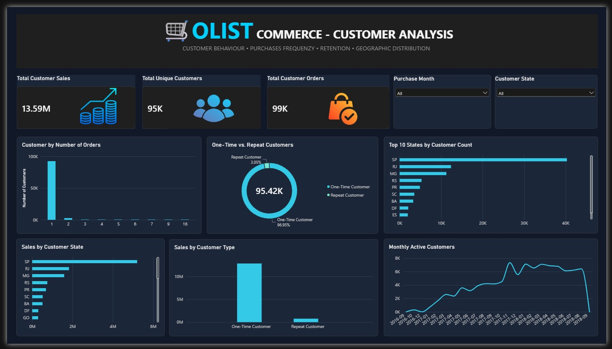
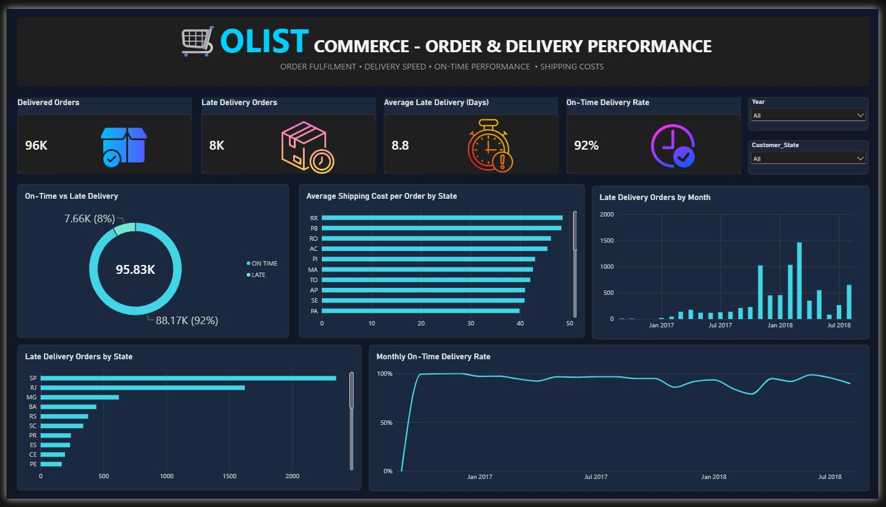

Olist E-Commerce Analytics

An end-to-end e-commerce data analytics project exploring sales performance, customer behavior, payment trends, and order delivery performance using SQL, Python, Pandas, and Power BI.

Project Overview

This project analyzes the Brazilian Olist e-commerce dataset to uncover meaningful business insights and understand key business performance indicators.

The workflow includes data exploration, data cleaning, preprocessing, SQL analysis, data modeling, DAX calculations, and interactive dashboard development.

## Dashboard Preview

### 1. Sales Overview

### 2. Payment Analytics

### 3. Customer Analysis

### 4. Order & Delivery Performance

Tools & Technologies

- SQL Server (SSMS) – Business queries and data analysis
- Python – Data cleaning and preprocessing
- Pandas – Data manipulation and transformation
- Power BI – Interactive dashboards and data visualization
- DAX – Measures and calculated metrics

Dashboard Pages

The Power BI report contains four analytical pages:

1. Sales Overview – Sales performance and key business metrics.
2. Payment Analytics – Payment methods and payment value analysis.
3. Customer Analysis – Customer behavior and order patterns.
4. Order & Delivery Performance – Delivery trends, on-time performance, delays, and shipping costs.

Project Workflow

1. Explored the Brazilian Olist e-commerce dataset.
2. Cleaned and preprocessed the data using Python and Pandas.
3. Performed business analysis using SQL.
4. Prepared datasets for Power BI.
5. Built the data model and relationships.
6. Created DAX measures for key performance indicators.
7. Designed interactive dashboards to communicate business insights.

Key Performance Areas

- Sales and revenue performance
- Payment value and payment methods
- Customer order behavior
- On-time delivery performance
- Late delivery analysis
- Average delivery time
- Shipping cost analysis

Repository Structure

Olist-Ecommerce-Analytics/
│
├── Dashboard-Screenshots/
│   ├── 01-Sales-Overview.jpg
│   ├── 02-Payment-Analytics.jpg
│   ├── 03-Customer-Analysis.jpg
│   └── 04-Order-Delivery-Performance.jpg
│
├── SQL-Analysis/
│   └── Olist_Ecommerce_Analysis.sql
│
├── Python-Analysis/
│   └── olist_data_preprocessing.py
│
└── README.md

Dataset

Brazilian Olist e-commerce public dataset, containing information about orders, customers, products, payments, reviews, and sellers.

Project Objective

To apply data analytics techniques to a real-world e-commerce dataset, identify meaningful business patterns, and present findings through interactive dashboards.

---

Project: Olist E-Commerce Analytics
Focus: Data Analysis | Business Intelligence | Data Visualization
Project Status

Completed – Four interactive Power BI dashboard pages.

Author

Muthu Kumar
